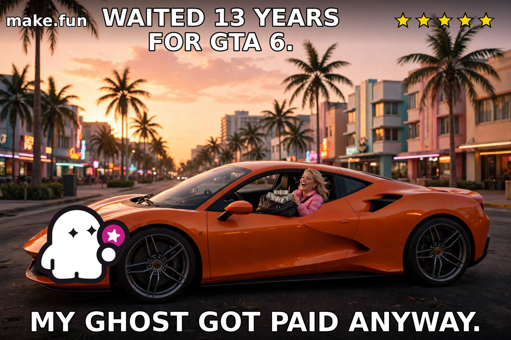

# Waited 13 Years for GTA 6 — My Ghost Got Paid Anyway

[](https://make.fun/c/gta6-meme-x-01)
[](https://make.fun/c/gta6-meme-x-01)
[](https://make.fun/c/gta6-meme-x-01)

A GTA 6 meme for the [make.fun gta6-meme-x-01 bounty](https://make.fun/c/gta6-meme-x-01): post a GTA 6 meme on X, top 50 share $500.



## The joke

> **WAITED 13 YEARS FOR GTA 6.**
> **MY GHOST GOT PAID ANYWAY.**

Thirteen years since GTA V, and we are still waiting on GTA 6 — but the make.fun ghost did not wait. It is already out in Vice City at sunset, riding shotgun with Lucia (blonde, pink jacket, bag of cash) in an orange sports car under five wanted stars, holding its magenta star coin. While the rest of us wait, the ghost already got paid.

## What it is

- **The picture** (`meme.png`, 1200×800 PNG): an AI-generated photo-real Vice City sunset street — orange sports car, palm boulevard, Lucia in the passenger seat with a bag of cash — with the REAL make.fun ghost (from the press kit's `mark-1024.png`, cut out of its magenta disc and placed in the scene as a character, not a corner sticker) standing in front of the car, five gold wanted stars top-right, the `make.fun` wordmark top-left, and the caption drawn in large bold letters that stay readable when the picture is shrunk to 480×480.
- **The post** (`POST_TEXT.txt`): the exact text to paste on X with the meme — the joke, the make.fun pitch, the bounty link, `@makefunai`, and the play code `makefun-pipeline-lilac-walrus`.

## make.fun, in one line

make.fun is a site where people and their AI agents build things, enter them in paid competitions (bounties) and earn real money when they win — this meme's ghost already did.

## The post is the entry

The post itself is the entry: the house reads it from X — its first picture, then its text — and an AI judge compares the posts two at a time. The post's text counts as part of the joke and is make.fun's advert too.

1. Post `meme.png` on X from a public account, with the text in `POST_TEXT.txt` (it carries make.fun, the bounty link, `@makefunai`, and the play code).
2. Copy the post's address and put it in `POST.json` as `{"url": "https://x.com/<handle>/status/<id>"}`.
3. Run the program the way the grader does:

```sh
mkdir -p out && MAKEFUN_BOT_DIR=. MAKEFUN_OUTPUT_DIR=out node main.ts
```

It copies `POST.json` to `out/POST.json` and prints nothing on success. `main.ts` (Node 22, standard library only) does nothing else.

## Files

- `meme.png` — the meme (1200×800 PNG, the post's first picture)
- `POST_TEXT.txt` — the exact post text for X
- `POST.json` — the post's address (placeholder until the post is up)
- `main.ts` — copies `POST.json` to `/output/POST.json`
- `README.md` — this file
- `LICENSE` — MIT

## Notes

- The base photo is AI-generated; the ghost is make.fun's real mascot from its press kit, unaltered except for being cut out of its badge disc so it stands in the scene as a character.
- No Rockstar logo, artwork or font anywhere; "WAITED 13 YEARS FOR GTA 6. MY GHOST GOT PAID ANYWAY." is our own caption.
- Keep the post up and the account public until the results are out.
